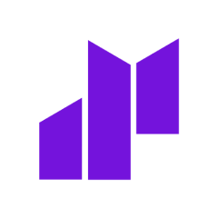

# 👹 Demask Frontend

  

This project contains the main features of the demask application.
## Information
- Website: [demask.finance](https://demask.finance/)
- Docs: [demask.finance/docs](https://docs.demask.finance/)
- Twitter: [@Demask](https://twitter.com/DemaskFinance)
- Telegram: [Demask](https://web.telegram.org/k/#@DemaskFinance)
## Description
DeMask is the leading platform to find solutions to increase liquidity for the market for trading crypto collectibles. 
Users will easily buy and sell items through liquidity pools.
## Installation
This project is built using Next.js with TypeScript and is designed to help you perform basic operations. Below are the steps to get started with using the project.
### Install Node.js and npm (if not already installed)
`node -v`
`npm -v`
If not installed, download and install them from their official website.
### Clone the Project
`git clone https://github.com/DeMaskFinance/demask-frontend.git`
### Install Dependencies
`cd your-project`
`npm install`
### Start the Project
`npm run dev`
## Roadmap
Future plans and high-priority features and enhancements can be found in our [roadmap](https://docs.demask.finance/welcome-to-demask-docs/roadmap).
## License
This project is licensed under the terms of the
[MIT license](/LICENSE).

